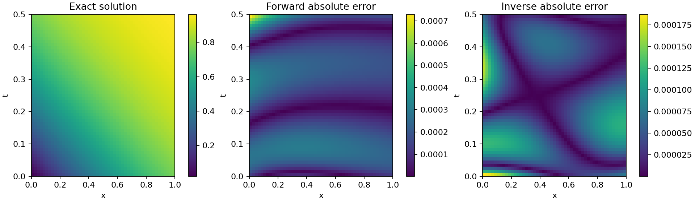
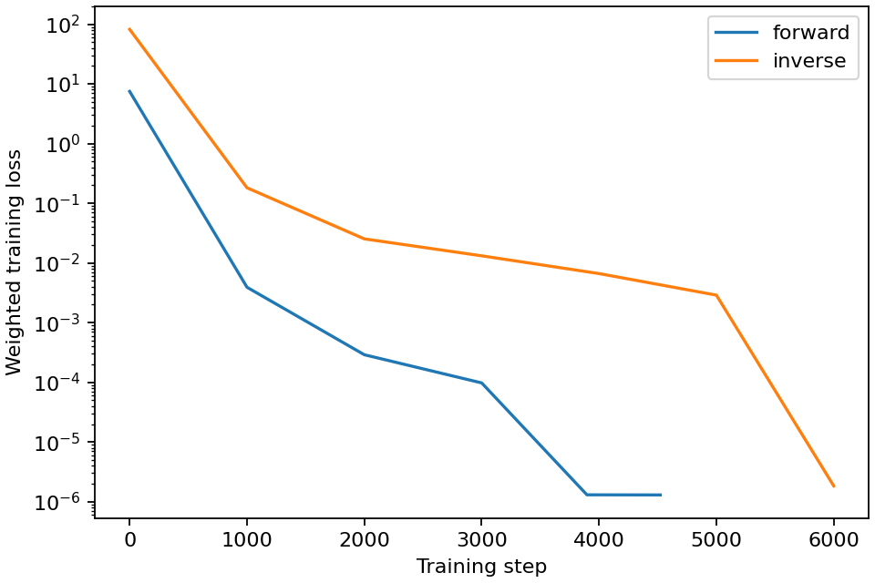

# Forward and Inverse PINNs for the Modified KdV Equation

A minimal, CPU-friendly [DeepXDE](https://deepxde.readthedocs.io/) project solving a nonlinear, third-order PDE. It compares a **forward PINN** with a **joint inverse PINN** that learns two unknown PDE coefficients from 64 interior observations and prescribed initial/boundary data.

## Equation and exact benchmark

$$
u_t + q u^2 u_x + r u_{xxx}=0, \qquad 0\le x\le 1,\quad 0\le t\le 0.5.
$$

The known exact solution and coefficients used to **generate and evaluate** this synthetic benchmark are

$$
u(x,t)=\tanh(x+2t),\qquad q=-6,\qquad r=1.
$$

These satisfy the PDE identically. The prescribed data are

$$
u(x,0)=\tanh x,\quad u(0,t)=\tanh(2t),\quad u(1,t)=\tanh(1+2t),
$$

$$
u_x(1,t)=\frac{1}{\cosh^2(1+2t)}.
$$


## Results from the included run

| Quantity | Exact | Predicted | Relative error |
|---|---:|---:|---:|
| $q$ | -6 | -5.98644322 | 0.22595% |
| $r$ | 1 | 1.00388017 | 0.38802% |

| Solution metric | Forward PINN | Inverse PINN |
|---|---:|---:|
| Relative $L^2$ error | 2.54551e-4 | 7.70079e-5 |
| Maximum absolute error | 7.29252e-4 | 1.87274e-4 |
| PDE residual RMS | 7.86894e-4 | 1.14931e-3 |





Both figures and the values in `results/metrics.json` were computed on a separate 51 × 51 interior evaluation grid. The two training-loss curves have **different loss terms and weights**, so compare each curve's convergence rather than their absolute magnitudes. These are results for **one synthetic, noise-free run**, not evidence of robustness to noisy observations.

## Run

Use **Python 3.11 or 3.12**, preferably inside a virtual environment:

```bash
python -m pip install -r requirements.txt
python generate_data.py
python train_forward.py
python train_inverse.py
python evaluate.py
```

The scripts request CPU execution. On a Linux/Windows CPU-only machine, you can install the smaller CPU PyTorch wheel first:

```bash
python -m pip install torch==2.7.1 --index-url https://download.pytorch.org/whl/cpu
```

This extra command is unnecessary on Apple Silicon. Your installed PyTorch wheel must be compatible with your Python version and platform.

## Files

| Script | Purpose |
|---|---|
| `generate_data.py` | Creates exact initial, boundary, observation and evaluation data. |
| `train_forward.py` | Trains $u_\theta(x,t)$ with $q=-6$, $r=1$. |
| `train_inverse.py` | Jointly trains $u_\theta(x,t)$ and the scalars $q$, $r$. |
| `evaluate.py` | Computes errors and regenerates the two figures. |

Outputs are saved under `results/`. Predictions are saved as NumPy arrays; model weights are not saved. `train_inverse.py` does not require running `train_forward.py` first, but both runs are required to regenerate the comparison figures.

## Numerical setup

- Network: `FNN([2, 32, 32, 1])` with `tanh` activations, `float64` precision.
- Interior PDE collocation: 512 randomly sampled points per run; the inverse model also adds the 64 observation coordinates as PDE anchors.
- Known initial and boundary constraints: 64 initial values, 128 boundary values and 64 right-boundary spatial derivative values.
- Inverse observations: 16 interior sensors at 4 times = **64 noise-free measurements** of $u$.
- Forward loss weights: `[1, 10, 10, 10]` (PDE, initial, boundary, right slope).
- Inverse loss weights: `[1, 10, 10, 10, 100]` (the same plus observations).
- Optimization: Adam (3,000 forward / 5,000 inverse steps), then DeepXDE's L-BFGS (`maxiter=1000`). In the supplied run, logged final steps are 4,522 forward and 6,000 inverse; DeepXDE's logged step numbers need not equal the requested L-BFGS iteration limit.
- Seeds: 1234 (forward), 1235 (inverse). Exact rerun results may vary by platform.

`PointSetOperatorBC` enforces the known right-boundary slope; `external_trainable_variables=[q, r]` makes both PDE coefficients trainable. The coefficients are unconstrained scalars. The evaluation grid is distinct from the prescribed observation grid.

The exact field gives $u_x=1-u^2$, $u_t=2(1-u^2)$ and $u_{xxx}=(6u^2-2)(1-u^2)$. Consequently,

$$
(1-u^2)\big[(2-2r)+(q+6r)u^2\big]=0.
$$

Since $u^2$ varies on the domain, this identity uniquely fixes $r=1$ and $q=-6$ **for the exact full field**. It does not establish stability of parameter recovery from noisy or incomplete data.

API reference: [DeepXDE inverse problems](https://deepxde.readthedocs.io/en/v1.14.0/demos/pinn_inverse/reaction.inverse.html).
